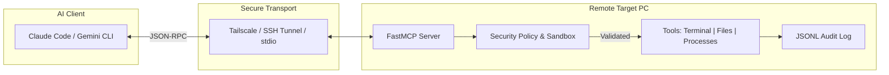

# AI Remote PC Control

<p align="center">
  
  
  
  
  
</p>

> **Secure, sandboxed Remote PC Control server powered by the Model Context Protocol (MCP).**  
> Seamlessly connect terminal AI agents (**Gemini CLI**, **Claude Code**, **Antigravity CLI**) to manage remote machines over private networks (Tailscale, WireGuard, SSH) without compromising security.

---

## 🌟 Highlights

- ⚡ **Remote Command Execution** (`run_command`): Subprocess execution with strict timeouts, directory constraints, and execution benchmarking.
- 📁 **Filesystem Sandboxing** (`read_file`, `write_file`, `list_dir`): Sandboxed read and write access with strict Path Traversal (`../`) prevention.
- 🔍 **Process Monitoring** (`list_processes`, `kill_process`): Real-time resource usage inspection with protection for system-critical PIDs (PID 0, 1, self).
- 🛡️ **Zero-Trust Safety Layer**:
  - Regex blacklist for destructive commands (`rm -rf /`, `mkfs`, partition writes, fork bombs).
  - Configurable binary whitelist for `safe-execute` mode.
  - Three distinct security modes: `read-only`, `safe-execute`, and `full-control`.
- 🤝 **Human-in-the-Loop Approvals**: High-risk actions automatically generate temporary approval tokens (`approval_id`) requiring human consent before execution.
- 📜 **Structured Audit Log**: Every tool call, attempted operation, status, duration, and output summary is logged to `logs/audit.jsonl`.
- 🔌 **Dual Transport Support**:
  - `stdio`: Direct execution or encapsulated within SSH tunnels.
  - `sse` (Server-Sent Events): Direct HTTP/JSON-RPC communication across private mesh networks (Tailscale).

---

## 🏗️ Architecture



---

## 📂 Repository Structure

```text
ai-remote-pc-control/
├── README.md                  # Project overview and documentation
├── architecture.md            # In-depth architectural design
├── .env.example               # Environment variables template
├── docker-compose.yml         # Containerized server configuration
├── agent/                     # Core MCP Agent
│   ├── main.py                # CLI runner (stdio and SSE support)
│   ├── mcp_server.py          # FastMCP server and tool registrations
│   ├── config.yaml            # Security policies, whitelists, and paths
│   ├── requirements.txt       # Python dependencies
│   ├── safety/                # Security subsystem
│   │   ├── policy.py          # Path sandboxing and command validation
│   │   ├── approvals.py       # Human confirmation workflow
│   │   └── audit.py           # Structured JSONL audit logging
│   └── tools/                 # Execution tools
│       ├── terminal.py        # Sandboxed shell commands
│       ├── files.py           # Sandboxed file operations
│       └── processes.py       # Process inspection and termination
├── docs/                      # Documentation guides
│   ├── setup-linux.md         # Linux setup instructions
│   ├── setup-windows.md       # Windows setup instructions
│   └── security.md            # Detailed security architecture
├── integrations/              # AI assistant client configurations
│   ├── claude/                # Claude Code integration
│   └── gemini/                # Gemini CLI extension
├── streaming/                 # Screen streaming module (Stage 4)
├── viewer/                    # Screen viewer application (Stage 6)
└── tests/                     # Test suite
    └── test_stage1.py         # Automated validation test
```

---

## 🚀 Quick Start

### 1. Prerequisites
- **Python 3.10+** (tested on 3.11, 3.12, 3.13, 3.14)
- **Linux** or **Windows**

### 2. Installation

Clone repository and prepare the virtual environment:

```bash
git clone https://github.com/Totsamuychel/ai-remote-pc-control.git
cd ai-remote-pc-control/agent

python3 -m venv .venv
source .venv/bin/activate
pip install -r requirements.txt
```

### 3. Configuration

Review `agent/config.yaml` to ensure your allowed directories and execution mode match your needs:

```yaml
security:
  mode: "safe-execute" # Options: read-only | safe-execute | full-control
  allowed_directories:
    - "/home/user"
    - "/tmp"
```

### 4. Run the Server

#### Option A: `stdio` mode (Local or through SSH tunnel)
```bash
python main.py --transport stdio
```

#### Option B: `sse` mode (Over private VPN / Tailscale)
```bash
python main.py --transport sse --host 0.0.0.0 --port 8000
```

---

## 🔌 Connecting AI Assistants

### Claude Code (`~/.claude/mcp.json` or project `.claude/mcp.json`)

```json
{
  "mcpServers": {
    "remote-pc": {
      "command": "/path/to/ai-remote-pc-control/agent/.venv/bin/python",
      "args": [
        "/path/to/ai-remote-pc-control/agent/main.py",
        "--transport",
        "stdio"
      ],
      "env": {
        "SECURITY_MODE": "safe-execute"
      }
    }
  }
}
```

*For SSH tunneling:*
```json
{
  "mcpServers": {
    "remote-pc": {
      "command": "ssh",
      "args": [
        "user@tailscale-ip",
        "source /path/to/.venv/bin/activate && python /path/to/agent/main.py --transport stdio"
      ]
    }
  }
}
```

### Gemini CLI (`~/.gemini/config.json`)

```json
{
  "mcpServers": {
    "remote-pc": {
      "command": "/path/to/ai-remote-pc-control/agent/.venv/bin/python",
      "args": [
        "/path/to/ai-remote-pc-control/agent/main.py",
        "--transport",
        "stdio"
      ]
    }
  }
}
```

---

## 🛠️ MCP Tools Reference

| Tool | Parameters | Description | Safety Behavior |
|---|---|---|---|
| `ping` | — | Check server connectivity and active security mode | Public |
| `run_command` | `command`, `cwd`, `timeout`, `approval_id` | Execute shell command within allowed working directory | Sandboxed; checks blacklist & whitelist |
| `read_file` | `path`, `max_bytes` | Read file contents (up to 2MB by default) | Sandbox boundary enforced |
| `write_file` | `path`, `content`, `append` | Create or modify file | Blocked in `read-only`; sandbox checked |
| `list_dir` | `path` | List files and metadata inside directory | Sandbox boundary enforced |
| `list_processes` | `limit`, `sort_by` | Inspect running system processes | Read-only |
| `kill_process` | `pid`, `force`, `approval_id` | Terminate process by PID | Protected PIDs guarded (PID 0, 1, self) |
| `pending_approvals`| — | List actions held for human review | Inspection |
| `approve_action` | `approval_id` | Approve held operation | Token authenticated |

---

## 🛡️ Security Model

| Security Mode | Allowed Operations |
|---|---|
| **`read-only`** | Diagnostic inspection only. `read_file`, `list_dir`, `list_processes`, safe inspection commands (`ls`, `cat`, `uptime`). No mutations. |
| **`safe-execute`** *(Default)* | Sandboxed file access. Whitelisted commands execute seamlessly. Unknown binaries or process termination require approval (`approval_id`). |
| **`full-control`** | Unrestricted command execution with blacklist filtering and comprehensive JSONL audit logging. |

### Global Blacklist
The following commands are **unconditionally blocked**:
- `rm -rf /`, `rm -rf /*`
- `mkfs`, `mkfs.*`
- `dd if=...`, direct disk overwrites (`> /dev/sda`)
- Fork bombs (`:(){ :|:& };:`)
- `chmod -R 777 /`
- Emergency shutdowns (`shutdown`, `reboot`, `poweroff`)

---

## 🧪 Testing

Run the automated test suite to verify all tools, sandbox policies, approval flows, and audit loggers:

```bash
python3 tests/test_stage1.py
```

Expected output:
```text
========================================
 ALL STAGE 1 TESTS PASSED SUCCESSFULLY! 
========================================
```

---

## 🗺️ Roadmap

- [x] **Stage 1: MVP** — Core FastMCP server, terminal commands, file sandboxing, process inspection, safety policy, and audit logging.
- [ ] **Stage 2: Client Integration** — Seamless setup for Claude Code and Gemini CLI extensions.
- [ ] **Stage 3: Screen & Windows** — Desktop screenshot capture (`screenshot`) and window inspection (`list_windows`).
- [ ] **Stage 4: Real-Time Streaming** — WebSocket video stream via FastAPI and `mss`.
- [ ] **Stage 5: GUI Control** — Mouse/keyboard automation with mandatory human approval.
- [ ] **Stage 6: Viewer App** — Cross-platform client for screen monitoring and telemetry.
- [ ] **Stage 7: Production Packaging** — Systemd services, zero-config installers, and Tailscale VPN orchestration.

---

## 📄 License

This project is licensed under the [MIT License](LICENSE).
