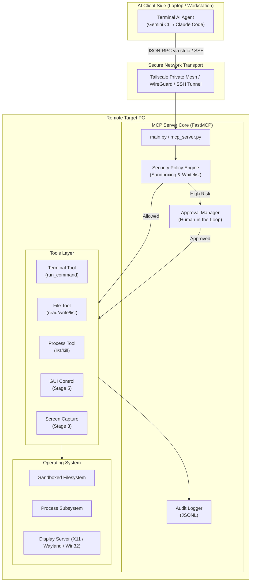

# AI Remote PC Control — Architecture & Specification

## 1. Executive Summary

**AI Remote PC Control** is an extensible, enterprise-grade Model Context Protocol (MCP) server architecture that enables AI agents (such as Gemini CLI, Claude Code, and Antigravity CLI) to securely interact with and control remote computers over private networks (Tailscale, WireGuard, or SSH).

The system enforces **Zero-Trust AI Execution**: every action, file access, and terminal command is subjected to path sandboxing, destructive pattern checks, whitelist policy enforcement, and audit logging. High-risk operations (such as unwhitelisted binaries or GUI automation) require explicit human consent.

---

## 2. System Architecture

---

## 3. Core Component Breakdown

### 3.1. MCP Server Core (`agent/mcp_server.py`, `agent/main.py`)
- Standards-compliant MCP protocol implementation via FastMCP.
- Dual transport capability:
  - **`stdio`**: For direct execution or encapsulation inside secure SSH tunnels.
  - **`sse`** (Server-Sent Events): For direct HTTP/JSON-RPC communication over encrypted VPNs (Tailscale).

### 3.2. Safety Layer (`agent/safety/`)
- **`SecurityPolicy`**:
  - Sandboxed path evaluation (`validate_path`) resolving symlinks and blocking Path Traversal (`../`).
  - Regex-based destructive command blacklist (`rm -rf /`, `mkfs`, partition writes, fork bombs).
  - Configurable execution modes: `read-only`, `safe-execute`, `full-control`.
- **`ApprovalManager`**:
  - Manages pending action queues with unique IDs and time-to-live expiration.
  - Enables supervisors to inspect and approve operations on demand.
- **`AuditLogger`**:
  - Immutable JSONL event logging capturing timestamp, tool name, arguments, status, duration, and output summaries.

### 3.3. Tools Layer (`agent/tools/`)
- **Terminal Execution** (`run_command`): Subprocess execution with enforced timeouts, sandboxed directory scoping, and error handling.
- **Filesystem Access** (`read_file`, `write_file`, `list_dir`): Sandboxed access to authorized project and home folders.
- **Process Management** (`list_processes`, `kill_process`): Safe process inspection with protected PID enforcement (PID 0, 1, self).

---

## 4. Security Modes

| Mode | Intended Use Case | Permitted Capabilities |
|---|---|---|
| `read-only` | Audit & diagnostic analysis | Only reading files, directory listing, system status inspection. Zero modifications. |
| `safe-execute` | Daily developer workflows | Whitelisted commands execute seamlessly. Unknown binaries or process kills require approval. |
| `full-control` | Unrestricted automation | Full command freedom with safety blacklist and full audit tracking. |

---

## 5. Development Roadmap

1. **Stage 1 (Completed)**: MVP — Remote command execution, filesystem sandbox, process inspection, safety layer, audit log.
2. **Stage 2**: Native client integration with Claude Code and Gemini CLI extensions.
3. **Stage 3**: Desktop screen capture (`screenshot`) and active window listing (`list_windows`).
4. **Stage 4**: Real-time video streaming service (FastAPI + WebSocket + JPEG / WebRTC).
5. **Stage 5**: Human-confirmed GUI automation (`click`, `type_text`, `press_key`).
6. **Stage 6**: Dedicated desktop/web Viewer application.
7. **Stage 7**: Zero-configuration packaging, systemd service, and Tailscale VPN automation.
